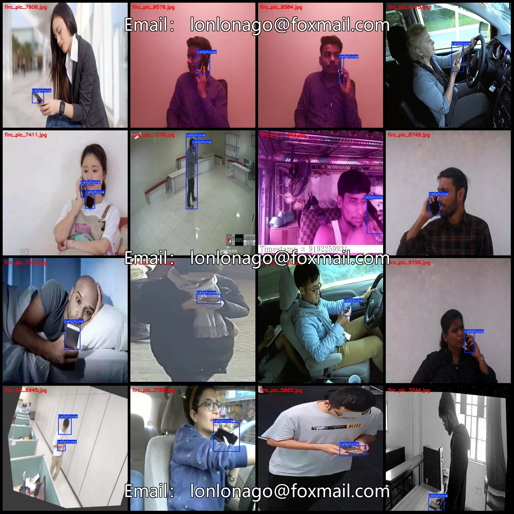
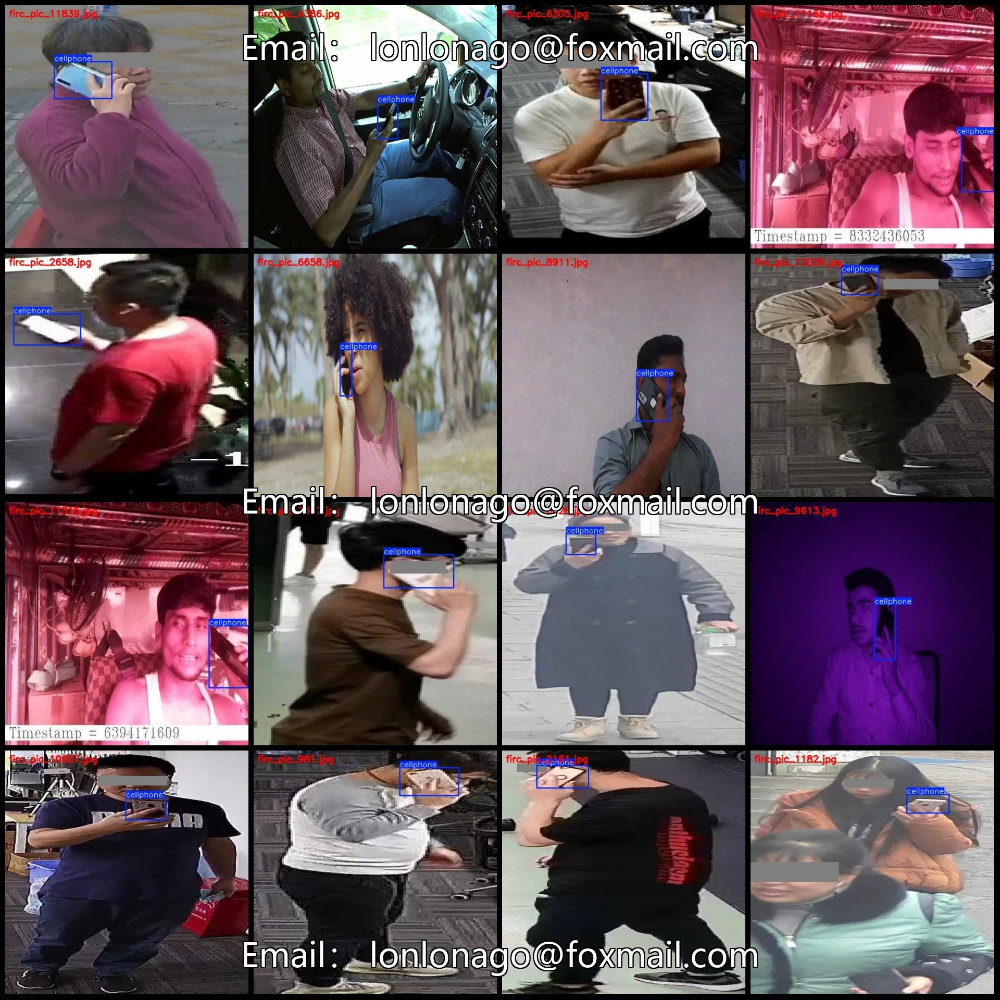
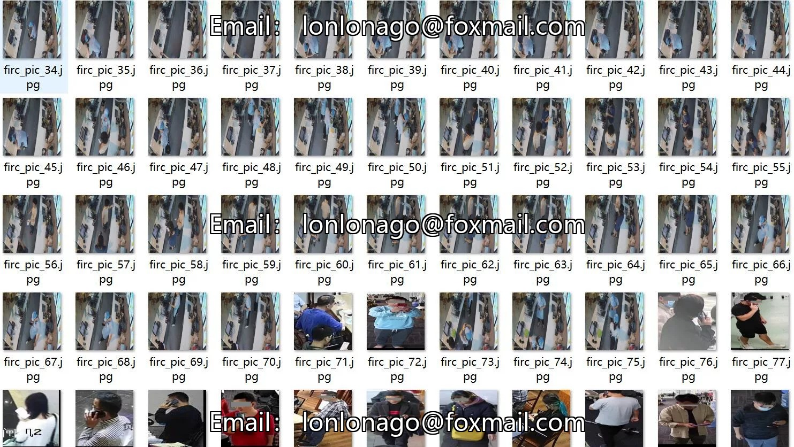
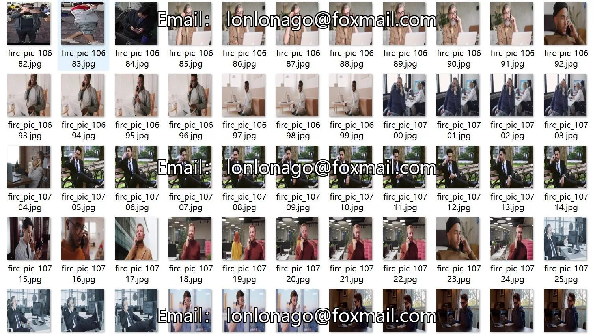
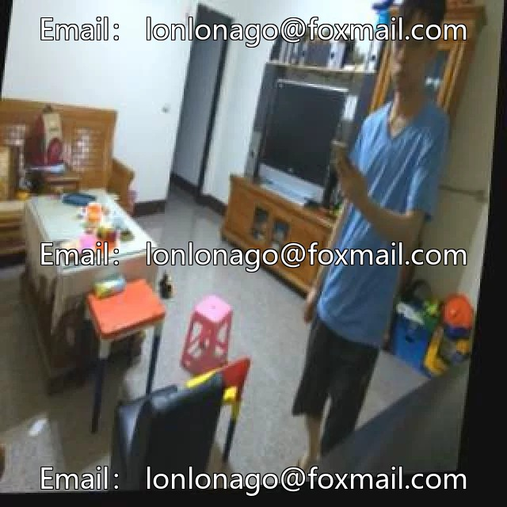

# Mobile phone usage and calling detection dataset VOC+YOLO format: 12319 images, 1 category

## Body

Mobile phone usage and calling detection dataset VOC+YOLO format: 12319 images in 1 category
Tips: Due to the dataset's replicability, please confirm compliance with requirements before purchasing.
Note: Some images in the dataset have human eye occlusion, and some are frame-extracted from videos, appearing as "duplicate" images. Please refer to the images for details.
Dataset format: Pascal VOC format + YOLO format (txt file without split paths, only containing jpg images and corresponding VOC format xml files and yolo format txt files)
Number of images (number of jpg files): 12319
Number of annotations (number of xml files): 12319
Number of annotations (number of txt files): 12319

Label Category Count: 1
Label Category Name: ["cellphone"]
Number of boxes and images occupied by each category:
- cellphone: 13565 boxes, 12319 images
Total number of boxes: 13565
Image resolution: 640x640
Labeling tool used: labelImg
Labeling rules: Draw a box around the category.
Important Note: The dataset does not have separate training, validation, or test sets; you need to partition them yourself.
Special Remarks: This dataset does not guarantee the accuracy of the trained models or weight files.

## Images

## Payment

Here is a pay link on Stripe ( https://buy.stripe.com/3cs8yP7sY87d0vu9AB ). Please contact me lonlonago@foxmail.com after funding $89, and I will send you a complete data files , thank you!

